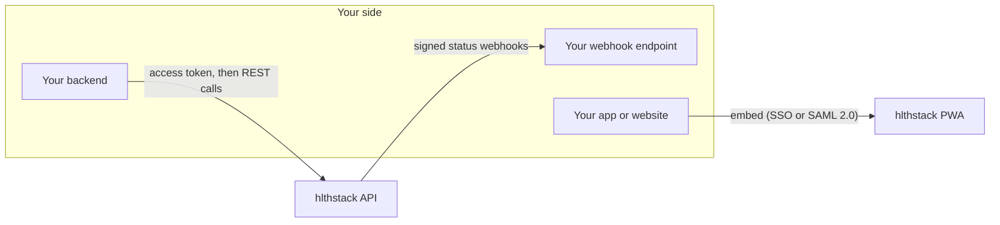

# hlthstack integration guide

[](https://github.com/hlthstack/integration-guide/releases)
[](LICENSE)
[](https://developers.hlthstack.io)
[](openapi/openapi.yaml)

hlthstack is a health-benefits API for partners. Through it you can book health checkups
and lab tests, in-clinic and online doctor consultations, and ePharmacy orders for your
members, check their benefit wallets, register your members and their dependants in bulk,
and receive status updates by webhook.

## Who is this for?

| You are | Start with |
|---|---|
| A product or business lead | [hlthstack for business teams](docs/for-business-teams.md): what members get, the ways to integrate, what your team decides and provides, and the path to go-live, without code. |
| A developer | [Getting started](docs/getting-started.md): from access request to go-live, including the member-app (PWA) embed track. |
| Anyone meeting an unfamiliar term | The [glossary](docs/glossary.md). |

## Start here

| Read the guides | Try in Postman | Use an SDK |
|---|---|---|
| [Getting started](docs/getting-started.md), the [guides](#guides) below and the [API reference](https://developers.hlthstack.io). | The [Postman docs](https://documenter.getpostman.com/view/32733686/2sBYHbrFjt), with a **Run in Postman** button, or [import the files](#resources). | [JavaScript](https://github.com/hlthstack/js) · [Python](https://github.com/hlthstack/python) · [Java](https://github.com/hlthstack/java). See [Install an SDK](#install-an-sdk). |

### Resources

| Resource | Where |
|---|---|
| API reference | https://developers.hlthstack.io |
| Postman docs | https://documenter.getpostman.com/view/32733686/2sBYHbrFjt, with a **Run in Postman** button |
| Postman files | In Postman choose **Import** and paste the [collection](https://developers.hlthstack.io/postman/hlthstack.postman_collection.json) link, then the [staging](https://developers.hlthstack.io/postman/hlthstack-staging.postman_environment.json) or [production](https://developers.hlthstack.io/postman/hlthstack-production.postman_environment.json) environment link. |
| OpenAPI spec | [`openapi/openapi.yaml`](openapi/openapi.yaml), version 1.0.2 |
| Changes | [CHANGELOG.md](CHANGELOG.md) |

## How an integration fits together



Your backend calls the REST API with a short-lived access token; hlthstack sends status
updates to your webhook endpoint. If you'd rather not build screens, embed the hlthstack
member experience (the PWA) in your app or site instead, or alongside the API.

## Ways to integrate

| Integration | What it is | Where |
|---|---|---|
| REST API | The HTTP API: reference, OpenAPI spec, guides and Postman collection | https://developers.hlthstack.io, and this repo: [`openapi/openapi.yaml`](openapi/openapi.yaml), [`docs/`](docs/) |
| JavaScript | Server-side SDK for Node.js, plus a guide to calling the API with plain `fetch` | https://github.com/hlthstack/js |
| Python | SDK (sync and async), plus a guide to calling the API with plain `requests` | https://github.com/hlthstack/python |
| Java | SDK for Java 11+, plus a guide to calling the API with the JDK's `HttpClient` | https://github.com/hlthstack/java |
| Web / PWA embed | Embed the hlthstack member experience in your app or site, with your own login (SSO) or the employer's identity provider (SAML 2.0) | https://github.com/hlthstack/web |
| AI assistant skills | A skill and plugin that teach Claude Code, Codex and ChatGPT to use this API | This repo: [`skills/`](skills/), install guide in [docs/ai-skills.md](docs/ai-skills.md) |

### Install an SDK

Install the JavaScript or Python SDK straight from GitHub:

```bash
npm install github:hlthstack/js#v1.0.2                            # JavaScript / TypeScript
pip install "git+https://github.com/hlthstack/python@v1.0.2"      # Python
```

Java: add the JitPack repository and depend on `com.github.hlthstack:java:v1.0.2`; see the
[Java SDK README](https://github.com/hlthstack/java#readme) for Maven and Gradle.

## Environments

| Environment | Base URL |
|---|---|
| Production | `https://api.hlthstack.io` |
| Staging | `https://staging-api.hlthstack.io` |

These hosts serve paths under `/api/` and the pre-registration paths under
`/v1/corporate/pre_registrations`. See [docs/environments.md](docs/environments.md).

> [!TIP]
> Make your first calls on staging. Staging has separate credentials and extra endpoints for
> simulating status changes, so you can test every flow before go-live.

## Getting credentials

Contact hlthstack through https://www.hlthstack.io/. At onboarding you receive:

| What you receive | When |
|---|---|
| An API username and password | Always, per environment |
| A separate pre-registration login (email and password) and your company ids | If you use pre-registration |
| Your package ids and plan ids | Always |
| Your company slug | For the wallet endpoints |
| Entity ids and an API secret key | For multi-entity partners |
| A webhook signing secret | Once you register your webhook URLs |

> [!CAUTION]
> Keep these credentials on your server. Never ship them in a mobile app or browser code. See
> [SECURITY.md](SECURITY.md#handling-your-credentials).

## Quickstart

Book a health checkup on staging with curl, from token to booking:

```bash
BASE=https://staging-api.hlthstack.io
# Replace these with your own values
PACKAGE_ID="<a package id from onboarding>"
PLAN_ID="<the plan id issued with it>"
PINCODE=500081   # example

# 1. Get an access token (valid 1 hour)
TOKEN=$(curl -s -u "$HLTHSTACK_USERNAME:$HLTHSTACK_PASSWORD" "$BASE/api/get-access-token" | jq -r .access_token)

# 2. Find providers for a health-check package near a pincode, and keep the first one
PROVIDER_ID=$(curl -s "$BASE/api/providers?service_name=ahc&package_ids=$PACKAGE_ID&pincode=$PINCODE&plan_id=$PLAN_ID" \
  -H "Authorization: Bearer $TOKEN" | jq -r '.providers[0].provider_id')

# 3. Get slots for that provider for the next 14 days (add &booking_date=YYYY-MM-DD for one day)
curl -s "$BASE/api/providers/$PROVIDER_ID/ahc/slots?package_ids=$PACKAGE_ID&pincode=$PINCODE" \
  -H "Authorization: Bearer $TOKEN" | jq '.booking_slots'

# 4. Book: set appointment_date_time to a utc_slot_time from step 3
curl -s -X POST "$BASE/api/appointments" \
  -H "Authorization: Bearer $TOKEN" -H "Content-Type: application/json" \
  -d '{
    "service_name": "ahc",
    "appointment_type": "inclinic",
    "plan_id": "'"$PLAN_ID"'",
    "provider_id": '"$PROVIDER_ID"',
    "appointment_date_time": "2030-01-15T02:30:00Z",
    "customers": [{
      "name": "Jane Doe", "dob": "1990-08-24", "gender": "female",
      "mobile_number": "9999999999", "api_customer_id": "CUST1001",
      "package_ids": ['"$PACKAGE_ID"']
    }]
  }'

# 5. Get the booking (booking_id from step 4)
curl -s "$BASE/api/appointments?booking_id=EKI0000000001700000000" \
  -H "Authorization: Bearer $TOKEN"
```

Then listen for webhooks to follow the appointment to `confirmed`, `completed` and
`received` (reports). See [docs/webhooks.md](docs/webhooks.md).

## Guides

The same guides open each section of the [API reference](https://developers.hlthstack.io)
and each folder of the [Postman docs](https://documenter.getpostman.com/view/32733686/2sBYHbrFjt).

<details>
<summary>The service guides (health checkups, consultations, ePharmacy, pre-registration) share one layout, so you always know where to look.</summary>

1. **Overview**
2. **Onboarding checklist**
3. **How it works**
4. **Types**
5. **Conventions and common errors**
6. **Rules and time windows**
7. **API reference** (one entry per endpoint, with its parameters, response and errors)
8. **Webhooks**
9. **Statuses**
10. **Troubleshooting**

</details>

### Start here

| Guide | What it covers | Read it when |
|---|---|---|
| [hlthstack for business teams](docs/for-business-teams.md) | A no-code overview for product and business leads: the services members get, the three ways to integrate (embed the member app, build with the API, or both) and their trade-offs, what your team decides and provides, onboarding to go-live, what members experience, support and security. | You are deciding whether and how to integrate, or briefing your team. |
| [Getting started](docs/getting-started.md) | The path from requesting access to going live: what you receive at onboarding, first calls on staging (Postman, curl or an SDK), building flows, webhooks, testing and the go-live checklist. | You are new to hlthstack, or planning an integration. |
| [Authentication](docs/authentication.md) | Exchanging your username and password for a 1-hour access token, sending it on every call, the extra headers for partners serving several employers (entities), and keeping credentials safe. | Before your first call. |
| [Environments](docs/environments.md) | Staging and production addresses, which credentials and ids differ between them, and recommended client timeouts. | Setting up configuration, and again before go-live. |
| [Glossary](docs/glossary.md) | Plain-language meanings of the terms used in these docs, from access token and AHC to webhook and white-labelling. | You meet an unfamiliar term. |

### Book and manage services

| Guide | What it covers | Read it when |
|---|---|---|
| [Health checkups and lab tests](docs/health-checkups.md) | Finding providers near a member, reading slots, booking at a centre or with home sample collection for one or several members, rescheduling and cancelling, and downloading the voucher, reports and lab results. Covers booking hours, notice periods, cut-offs, co-pay links and every appointment status. | You offer health checkups, lab tests, dental, vision or vaccinations. |
| [Consultations](docs/consultations.md) | The three consultation types (in-clinic, scheduled online by audio or video, and priority online, where a doctor calls within about 4 hours), booking, reschedule and cancel rules, refunds, uploading reports for the doctor, and the summary and prescription after the call. | You offer doctor consultations. |
| [ePharmacy](docs/epharmacy.md) | Searching medicines, digitizing a prescription, building the cart, choosing home delivery or store pickup, and creating the order. Covers the three payment flows (covered by the wallet, a payment link for the member, or collected by you), substitutions, split orders and every order status. | You offer medicine orders. |
| [Wallet and subscriptions](docs/wallet.md) | Reading a member's benefit balances and plan subscriptions, and choosing which subscription pays for a booking. | You show members their benefits, or members have more than one plan. |
| [Pre-registration](docs/pre-registration.md) | Registering employees and their dependants in bulk (up to 250 rows a request), updating and deactivating them, with its own login and token. Each request returns a `request_id`; poll its status for each row's outcome, and resend only the failed rows. | You load members before they first sign in. |

### Follow what happens

| Guide | What it covers | Read it when |
|---|---|---|
| [Webhooks](docs/webhooks.md) | Verifying each delivery's signature (with Node.js and Python code), delivery timeouts and retries, ordering and duplicates, and the payloads for appointments, consultations, lab results, pharmacy orders and prescription digitization. | Before you build your webhook endpoint. |
| [Product communications](docs/product-communications.md) | The emails, WhatsApp, SMS, in-app and push messages hlthstack sends your members for pharmacy, vision and consultations: which message, on which channel, and when. | Designing your own notifications, so members don't get the same message twice. |
| [White-labelling](docs/white-labelling.md) | Sending those messages under your app name, sender name and logo, by email only or by email, WhatsApp and SMS, and how to set it up. | Members should see your brand rather than hlthstack's. |

### Handle errors

| Guide | What it covers | Read it when |
|---|---|---|
| [Common errors and how to fix them](docs/common-errors.md) | The errors partners hit most often, grouped by sign-in, packages and providers, slots, booking, reschedule and cancel, and results: why each happens and what to change. | A call fails and you want the fix. |
| [Errors](docs/errors.md) | Every error body shape and status code the API returns, the common messages, and which errors are safe to retry. | Writing your error handling. |
| [FAQ](docs/faq.md) | Short answers on tokens, entities, booking vs appointment ids, reschedule and cancel cut-offs, webhooks, pre-registration, timeouts and rate limits. | You have a quick question. |

### Test and go live

| Guide | What it covers | Read it when |
|---|---|---|
| [Testing on staging](docs/testing.md) | Staging-only endpoints that move a booking, consultation or pharmacy order through each status and fire the real webhooks, plus a checklist of what to test. | Testing end to end before go-live. |

### Tools

| Guide | What it covers | Read it when |
|---|---|---|
| [AI coding assistant skills](docs/ai-skills.md) | Installing the hlthstack skill in Claude Code, Codex or ChatGPT, so the assistant knows the API, flows and webhooks; example prompts and safety notes. | Your developers use an AI coding assistant. |

## Support

| For | Where |
|---|---|
| Questions and access | Your hlthstack account contact, or https://www.hlthstack.io/ |
| Problems with the docs | This repository's issues |
| Security issues | Privately, as described in [SECURITY.md](SECURITY.md) |

## License

[MIT](LICENSE)
